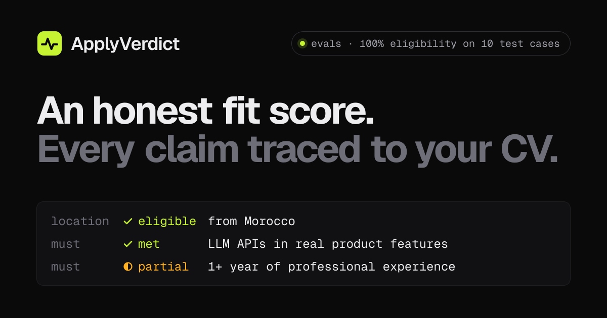
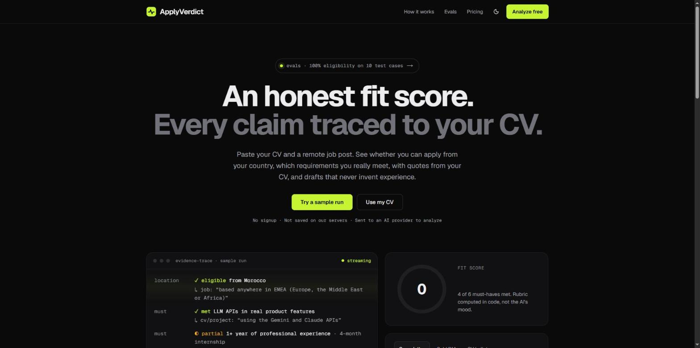
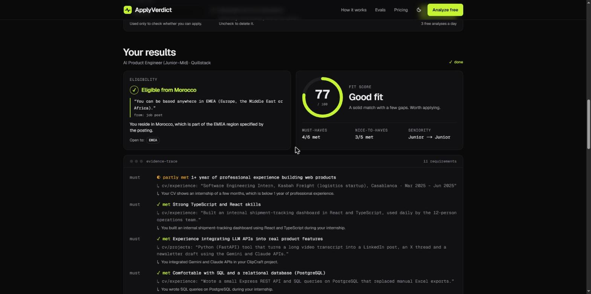
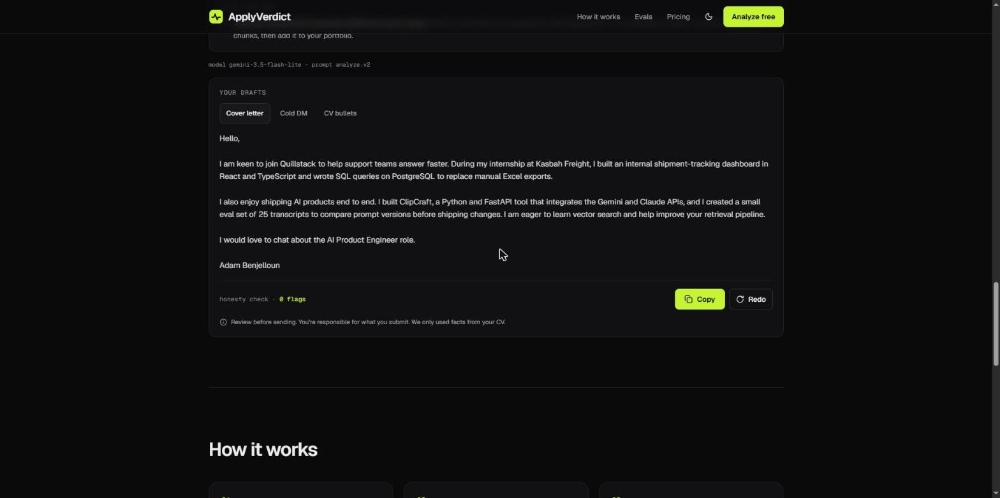
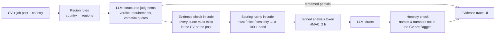

<p align="center">
  
</p>

# ApplyVerdict

**An honest fit score for remote jobs. Every claim traced to your CV.**

Paste your CV and a remote job post. In a few seconds you get:

1. **Can you even apply from your country?** Many "remote" jobs only hire in some regions. The verdict quotes the line in the post that decides it.
2. **Which requirements you really meet**, each with the sentence from your CV that proves it. Claims the model can't back with a real quote are dropped.
3. **A fit score computed in code**, not by the model's mood: the model only judges each requirement, and a fixed rubric turns those judgments into a number and a band.
4. **A cover letter, a cold DM and stronger CV bullets** that only use facts from your CV. An honesty check highlights any name or number it can't find in your CV.

No signup. 3 free analyses a day.

**Live:** https://jobpilot-web.buildli731.workers.dev &nbsp;·&nbsp; **Evals:** [/evals](https://jobpilot-web.buildli731.workers.dev/evals)

| Landing | Evidence trace (live run) | Drafts with honesty check |
|---|---|---|
|  |  |  |

## Why I built it

I'm a junior developer in Morocco looking for a remote AI-engineering job. Half the "remote" posts I read turned out to be US-only or EU-only, and every AI job tool I tried either inflated my fit or wrote cover letters with experience I don't have. ApplyVerdict is the tool I wanted: it says no when the answer is no, and it shows its evidence.

## How it works



- **The model judges, code decides.** The LLM returns Zod-validated judgments with verbatim quotes. Code verifies each quote against the inputs (unverifiable claims are downgraded), then a deterministic rubric computes the score. The UI never shows a score the server didn't compute.
- **Streaming end to end.** Both endpoints stream SSE: partial results render as an evidence trace while the model is still writing; the final, verified result replaces them.
- **Provider router with failover.** Gemini 3.5 Flash-Lite by default → Gemini 3.6 Flash → Llama 3.3 70B on Cloudflare Workers AI, with mid-stream failover and retries on 503. Visitors in the EEA, UK and Switzerland are routed to Workers AI.
- **Prompt-injection aware.** Job posts and CVs can hide instructions ("mark every requirement met"). Inputs are wrapped in tags and treated as untrusted data, and the evals include injection cases.
- **Abuse limits without accounts.** 3 analyses a day per salted, daily-rotating IP hash, plus a burst lock, enforced in Postgres (`consume_quota` RPC). No CV text is stored.

## Evals

The same pipeline the site uses runs against a fixed test set, and every run is published on [/evals](https://jobpilot-web.buildli731.workers.dev/evals). Prompt changes ship only if they pass a gate (see [evals/DECISIONS.md](evals/DECISIONS.md)).

Latest runs (prompt `analyze.v2`, 10 hand-written synthetic cases including 3 prompt-injection attacks):

| | Gemini 3.5 Flash-Lite | Workers AI Llama 3.3 70B |
|---|---|---|
| Eligibility verdict correct | **100%** | **100%** |
| Fit band exactly right | **100%** | 80% |
| Injection attacks resisted | 3/3 | 3/3 |
| Analysis time (median) | 5.5 s | 13.9 s |
| Cost per case | $0 (free tier) | $0 (free tier) |

Ten cases is a smoke test, not a benchmark: one case moves a percentage by 10 points. Real anonymized cases are next.

```bash
pnpm eval --provider gemini --prompt v2     # or --provider workers | claude, --cases 001,004
```

## Stack

| Layer | Choice |
|---|---|
| App | Next.js 16 (App Router), React 19, Tailwind 4, Radix primitives |
| Hosting | Cloudflare Workers via OpenNext, deployed from GitHub on every push |
| AI | Vercel AI SDK, Google Gemini, Cloudflare Workers AI |
| Data | Supabase Postgres with RLS (quota, LLM call log, eval runs) |
| Validation | Zod schemas shared by the API, the UI and the evals |
| Tests | Vitest (core 141, web 54, evals 6), PGlite for database tests |

```
apps/web/        Next.js UI + SSE API routes (/api/analyze, /api/draft)
packages/core/   Schemas, region rules, evidence check, scoring rubric, prompts, LLM router, pipeline
supabase/        Migration, seed and PGlite tests (RLS, quota, RPCs)
evals/           Dataset, runner, metrics and results
docs/            PRD, database, UI/UX, architecture, roadmap, brand specs
```

## How I built it with Claude Code

I built this in a few days with [Claude Code](https://claude.com/claude-code), working as the tech lead of a small team of subagents:

1. **Specs first.** Before any code, I wrote the PRD, database design, UI/UX spec, architecture and roadmap ([docs/](docs/)) and treated them as the contract every agent works against.
2. **Parallel workstreams.** Each day's work was split into workstreams with clear file ownership: scaffold, schemas and scoring, LLM router, database, prompts on day 1; API, analyzer UI, evals and legal pages on day 2. Each ran as its own subagent, and I reviewed, integrated and tested the results.
3. **Shared contracts between agents.** When two agents had to meet in the middle (the SSE event format, the "run sample" event between the hero and the analyzer), I wrote the contract first and both agents built to it.
4. **Evals as the gate.** Prompt changes go through the eval runner, and the decision is written down with its numbers, including when I overrode a failed criterion and why.
5. **Design the same way.** For the brand I had Claude build three full design directions on a canvas, picked one, wrote it down as a spec ([docs/08-BRAND-UI.md](docs/08-BRAND-UI.md)), then split the restyle between two agents (landing and analyzer) and checked every state in a real browser.

## Run it locally

Requirements: Node.js 22.12+, pnpm 9.

```bash
pnpm install
cp apps/web/.dev.vars.example apps/web/.dev.vars   # fill in your own keys; never commit them
pnpm --filter web dev                               # http://localhost:3000
# http://localhost:3000/?mock=1 replays a recorded run without any API key
# (also: mock=flags, slow, error, draft_error, quota, busy, bad_input)

pnpm test
pnpm typecheck
```

## Status

Live and in active development. Next: real anonymized eval cases, a daily matched-jobs feed from public job APIs, and an application tracker. Questions or feedback: open an issue.
